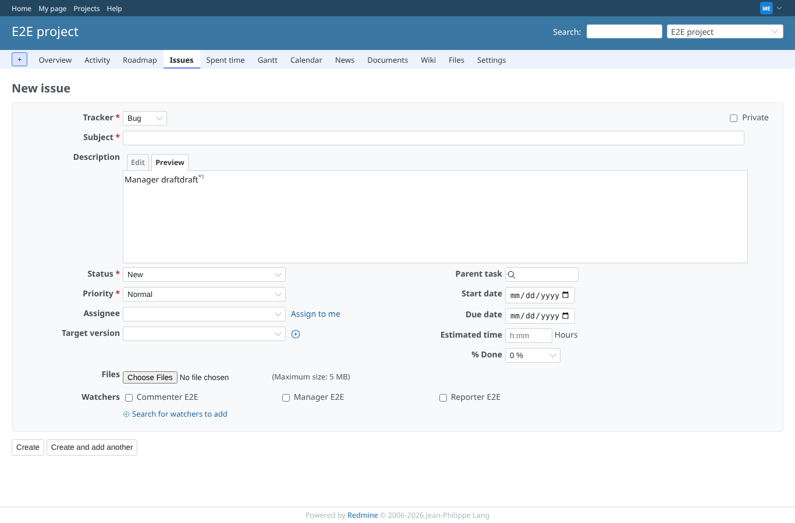
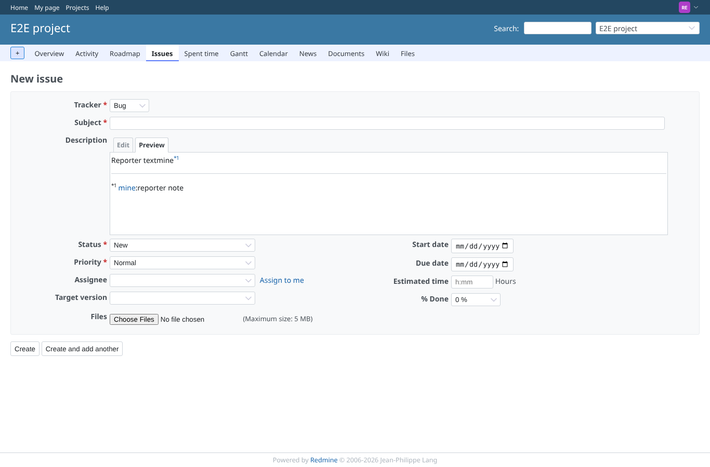
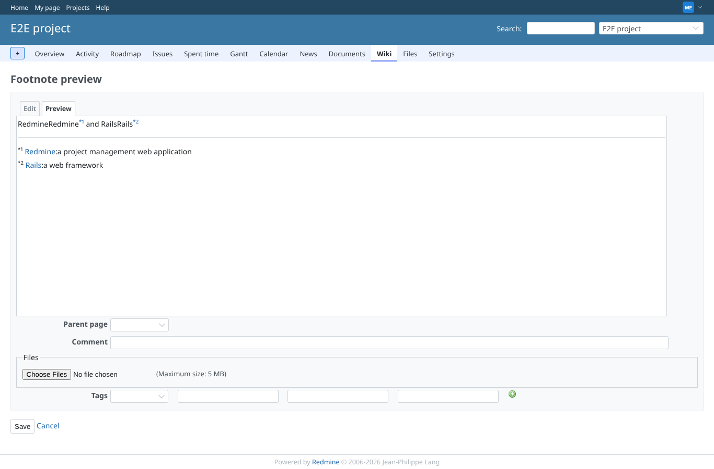

# footnotes

Run 2026-10-29T05:22:23.134Z against http://127.0.0.1:3000.

| screenshot | user | URL | shows |
|---|---|---|---|
|  | manager | `/projects/e2e-project/issues/new` | manager previews a new issue with a footnote and no fnlist: the footnote is marked *1 |
|  | reporter | `/projects/e2e-project/issues/new` | reporter previews right after: only "mine: reporter note", numbered *1, nothing of the manager's preview |
|  | manager | `/projects/e2e-project/wiki/Footnote_preview` | Preview of a new wiki page: footnotes *1 and *2 and their list, as before |
